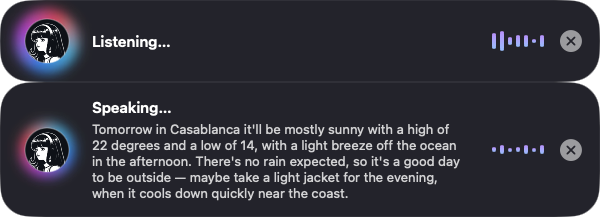

# Hermes Bubble 🌐

**Hold the Globe key, talk to Hermes, hear the answer.** A Siri / Google-Assistant-style voice bubble for [Hermes Agent](https://github.com/NousResearch/hermes-agent) on macOS.

- **Hold 🌐 (fn)** anywhere → an animated Hermes bubble appears and listens
- **Speak** in your language → Hermes answers **out loud**, in the same language, short and to the point
- **Keep talking** — the bubble stays open for follow-ups until you click **✕**
- **Continue by typing** — click the notification to open the same conversation in Terminal
- **Do things, not just chat:** YouTube & Spotify control, open apps, Google search, websites, WhatsApp calls, volume, timers, read your screen, answer from the web



See **[GUIDE.md](GUIDE.md)** for everything you can say.

## Install (one shot)

```bash
hermes plugins install Androbito/hermes-bubble --enable
hermes bubble install
hermes gateway restart        # only if the installer just enabled the API server
```

Then grant **Input Monitoring** to *HermesKey* (the installer opens the right Settings page), run `hermes bubble restart`, and hold 🌐.

Optional: pick a fast model and the languages you speak:

```bash
hermes bubble install --provider anthropic --model claude-haiku-4-5 --languages en,fr,ar
# or later:
hermes bubble config provider=openrouter model=openai/gpt-5-mini languages=en,es
hermes bubble restart
```

## Requirements

- **macOS 14+**, a microphone, and Apple's command line tools (`xcode-select --install`) — the bubble app is compiled locally from source (`app/HermesKey.swift`), nothing prebuilt is shipped
- **Hermes Agent** with a working model provider
- **Computer Use** enabled in `hermes tools` (installs Cua Driver) — needed for YouTube player buttons and WhatsApp calls
- Optional: Google Chrome (YouTube, search, history), Spotify desktop app, WhatsApp desktop app, BBEdit

## What the installer does

| Step | Details |
|---|---|
| Voice stack | installs Hermes' `voice` extra (faster-whisper local speech-to-text, sounddevice) |
| Settings | `~/.hermes/bubble/config.json` — model, languages, browser profile, timings |
| API server | adds `API_SERVER_ENABLED` + a random `API_SERVER_KEY` to `~/.hermes/.env` (127.0.0.1 only, asks first) so answers come from the running gateway (~2–4 s) instead of spawning a CLI per question |
| Tools | enables `web` + `computer_use` for the API server **and for the CLI** (the fallback path when the API server is down) so the bubble can search the web and read the screen. This changes what your normal `hermes` CLI can do too |
| App | builds and signs `~/.hermes/bubble/HermesKey.app` (uses your Apple Development certificate if you have one, otherwise ad-hoc) |
| Login item | `~/Library/LaunchAgents/io.github.hermes-bubble.hermeskey.plist` |

## How it works

```
🌐 hold ──► HermesKey.app (Swift: key listener + animated HUD + notifications)
               │  Unix socket
               ▼
          voice worker (Python, inside Hermes' runtime, model kept warm)
            1. record until you pause  →  2. local Whisper (restricted to your languages)
            3. instant ⚡ commands (regex)  — or —  Hermes API server (your model, web + screen tools)
               └─ the model can reply `ACTION {...}` to trigger a bubble action
            4. text-to-speech, first sentence first (Hermes' TTS, macOS `say` fallback)
```

Note: the runtime uses a few internal Hermes modules (voice, TTS, web search); a Hermes release may occasionally require a plugin update.

Safety model: the bubble's prompt tells the agent it may **look** (screen, web) but must never click or type, and to request one of the fixed actions in `runtime/actions.py` instead, which run outside the agent's tools. This is a prompt rule, not a sandbox: `computer_use` stays fully enabled for the API server, so a web page or on-screen text written to mislead the model could still make it act. Keep that in mind when you ask it to read untrusted content.

Conversations: one Hermes session per bubble conversation; a new one starts when you click ✕, after 10 minutes of silence, or after 30 turns. The worker restarts itself every 6 h (when idle) and HermesKey respawns it if it dies.

## Manage

```bash
hermes bubble status          # health check (app, worker, permissions, API server, Cua Driver)
hermes bubble stop | start | restart
hermes bubble config          # show settings
hermes bubble uninstall [--purge]
hermes plugins remove hermes-bubble
```

Logs: `~/.hermes/bubble/ask.log` (turns + timings), `~/.hermes/bubble/fnkey.log` (key + app). Each rolls over to `.1` past 2 MB.

## Privacy

- Speech-to-text runs **locally** (faster-whisper). Audio is never uploaded.
- What you say is sent to **your** configured Hermes model, like any Hermes chat.
- The key listener only watches the 🌐 key's press/release (read-only event tap). It never records other keystrokes.
- History search reads your local Chrome `History` file on demand; nothing is copied elsewhere.
- Spotify searches and the model's web answers go through Hermes' web search provider. YouTube searches are fetched from youtube.com directly, without your account.

## Customise

- Add instant commands: `_FAST` / `_FAST_MORE` regex tables in `runtime/actions.py`
- Add model-triggered actions: add an entry to `ACTIONS` in the same file (the prompt text the model sees is generated from it)
- Tune the bubble look: `HUDView` in `app/HermesKey.swift`, then `hermes bubble install` to rebuild

## License

MIT
